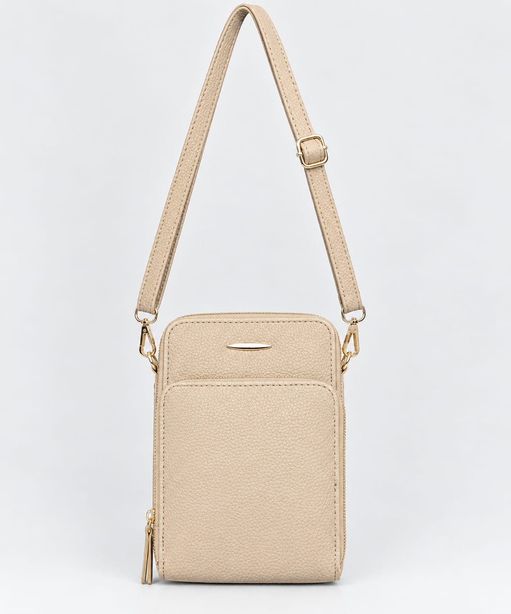

A ideia é seguir o mesmo padrão das imagens que fizemos: fundo branco ou cinza bem clarinho, iluminação suave, bolsa centralizada e alça aparecendo conforme o modelo original.

### Prompt padrão profissional para suas bolsas

Transforme a foto enviada em uma fotografia profissional de estúdio para catálogo de uma loja de bolsas femininas, com aparência realista, elegante, limpa e de alta qualidade.

**1. PRESERVAÇÃO TOTAL DO PRODUTO**
Utilize a bolsa da foto original como referência obrigatória e preserve fielmente o produto real. Não redesenhe, não invente e não substitua nenhuma característica da bolsa. Mantenha exatamente as cores originais, a tonalidade do material, a textura, o formato, as proporções, o tamanho relativo, as costuras, os bolsos, os zíperes, os puxadores, os fechos, as fivelas, as argolas, as correntes, os pingentes, as franjas, as etiquetas e todos os acabamentos. Não altere a cor do metal nem o brilho natural do material. Não adicione nem remova detalhes da bolsa.

**2. FORMATO E PROPORÇÕES**
Mantenha o formato exato da bolsa original. Respeite se ela é arredondada, retangular, alongada, compacta, estruturada, flexível, larga, estreita, alta ou baixa. Não transforme uma bolsa alongada em uma bolsa carteiro, não deixe uma bolsa arredondada quadrada e não altere a altura ou a largura do produto. Preserve o volume e o caimento naturais.

**3. ALÇAS — MUITA ATENÇÃO**
Reproduza as alças exatamente como existem na bolsa original. Se a bolsa tiver alça transversal, mostre-a completamente, formando um arco alto e natural acima da bolsa, com comprimento suficiente para deixar claro que é uma alça de uso transversal. Preserve a largura, a cor, a textura, as costuras, os reguladores, as fivelas, as argolas e os mosquetões originais.

Se a alça for fixa, mantenha-a fixa e respeite sua ligação com a bolsa, inclusive quando estiver presa nas laterais até a parte inferior. Se for removível, preserve os encaixes originais. Não invente uma alça, não remova uma alça existente e não faça parecer removível uma alça que é fixa. Não confunda alça de mão com alça transversal.

Organize a alça de maneira bonita e visível, sem esconder partes importantes do produto, sem cortes e sem deformações.

**4. REMOÇÃO DO AMBIENTE ORIGINAL**
Remova completamente a cadeira, os móveis, as pessoas, as roupas, os objetos, as embalagens e todos os elementos que aparecem ao redor da bolsa. Não deixe partes da cadeira atravessando a alça ou aparecendo atrás do produto. Isole a bolsa com cuidado, preservando suas bordas e todos os seus detalhes.

**5. FUNDO DE ESTÚDIO**
Substitua o ambiente original por um fundo de estúdio liso, branco ou cinza muito claro, neutro e discreto. Utilize uma composição minimalista, sofisticada e adequada para um catálogo de moda feminina e uma loja virtual. O fundo deve ser uniforme, sem objetos decorativos, sem estampas, sem texturas fortes e sem elementos que disputem a atenção com a bolsa.

**6. ILUMINAÇÃO E QUALIDADE FOTOGRÁFICA**
Use iluminação profissional suave, uniforme e difusa, semelhante à de um estúdio fotográfico de produtos. Preserve a aparência natural do material, os relevos, as costuras e a textura da bolsa. Mantenha sombras suaves e discretas, sem escurecer excessivamente o produto. A imagem deve ser nítida, bem definida e realista, com aparência de fotografia comercial feita com câmera profissional.

**7. ENQUADRAMENTO**
Mostre a bolsa de frente, centralizada, em posição reta e simétrica, com a parte frontal totalmente visível. Deixe espaço suficiente ao redor do produto para que nenhuma parte da bolsa ou da alça seja cortada. A bolsa deve ocupar boa parte da imagem, mantendo uma composição equilibrada e adequada para anúncios, catálogo digital, redes sociais e loja virtual.

Se a foto original mostrar detalhes laterais importantes para compreender a estrutura da alça, use essas informações como referência, mas produza somente a imagem frontal solicitada.

**8. PROIBIÇÕES IMPORTANTES**
Não aplique filtros de beleza, filtros de cor, efeitos cinematográficos, saturação artificial, alteração de temperatura de cor ou retoques que mudem a aparência real do produto. Não clareie nem escureça a bolsa artificialmente. Não mude o bege para caramelo, o marrom para avermelhado, o cinza para bege ou qualquer outra tonalidade. Não altere o material, não suavize excessivamente a textura, não apague costuras, não modifique logotipos, não invente bolsos ou zíperes e não acrescente acessórios inexistentes.

**RESULTADO FINAL**
Uma fotografia de estúdio realista, limpa, elegante e profissional, com fundo claro, bolsa frontal centralizada, cores fiéis à fotografia original, formato preservado, detalhes intactos e alça corretamente representada conforme o modelo real. Priorize a fidelidade absoluta ao produto em vez de alterações criativas. A imagem deve parecer uma fotografia profissional da mesma bolsa, e não uma bolsa recriada ou um modelo semelhante.

### Como usar para cada tipo de bolsa

Você pode copiar o prompt acima e acrescentar uma destas instruções ao final:

Bolsa com alça transversal

“Mostre a alça transversal inteira, aberta em um arco alto acima da bolsa, com os dois pontos de fixação visíveis e o comprimento natural preservado.”

Bolsa sem alça transversal

“Não acrescente alça transversal. Mostre apenas as alças existentes no produto, mantendo seus encaixes e seu formato original.”

Bolsa mais longa ou arredondada

“Respeite rigorosamente o formato e as proporções da referência. Preserve a bolsa alongada ou arredondada conforme o modelo, sem transformá-la em uma bolsa quadrada ou estilo carteiro.”

### Dica importante para conseguir um resultado melhor

Sempre envie a foto original da bolsa e, quando necessário, uma segunda foto mostrando a lateral ou a alça. Isso ajuda a preservar os detalhes corretos.

O mais importante: a inteligência artificial deve mudar o cenário e a apresentação da fotografia, não o produto. Como você usa as imagens para vender bolsas, a fidelidade das cores, do formato e dos acessórios é essencial para que a cliente receba algo igual ao que viu na foto.
26/10/2026 12:50 - Honório: PROMPT MESTRE — TRANSFORMAR FOTO DE BOLSA EM FOTO DE ESTÚDIO

Objetivo: Transformar a fotografia original da bolsa em uma imagem profissional de catálogo de e-commerce, com aparência de fotografia real feita em estúdio, mantendo a máxima fidelidade ao produto original.

1. PRESERVAÇÃO DO PRODUTO ORIGINAL

Use a imagem enviada como referência visual obrigatória. Reproduza exatamente a mesma bolsa que aparece na fotografia, sem substituir, redesenhar, estilizar ou modificar o produto.

Preserve rigorosamente:

- A cor original da bolsa, sem mudar tonalidade, saturação ou temperatura de cor.
- O material, a textura, o relevo e o acabamento originais.
- O formato, as proporções, as dimensões aparentes e a estrutura da bolsa.
- As costuras, linhas, bordas, divisórias, bolsos, fechos, zíperes e botões.
- Os logotipos, placas metálicas, inscrições e acessórios originais, respeitando sua posição e aparência.
- As alças, argolas, mosquetões, fivelas, reguladores e demais ferragens.
- Os pingentes, pompons, correntes, pérolas e outros enfeites, quando existentes.
- A quantidade de alças e todos os elementos presentes no produto original.

Não adicione elementos inexistentes e não remova detalhes que façam parte da bolsa.

2. REMOÇÃO COMPLETA DO AMBIENTE ORIGINAL

Remova integralmente o cenário da fotografia original, incluindo cadeira, cama, mesa, paredes, janelas, objetos, pessoas, caixas, tecidos e quaisquer outros elementos que não façam parte da bolsa.

Reconstrua as áreas ocultas pelo suporte original de maneira natural e coerente, preservando a geometria real do produto.

A bolsa deve aparecer isolada, sem cadeira, cabide, mão, manequim ou qualquer suporte visível.

3. CENÁRIO PROFISSIONAL DE ESTÚDIO

Crie um cenário minimalista de fotografia comercial de produtos, com:

- Fundo infinito liso em branco suave ou cinza muito claro.
- Superfície inferior integrada ao fundo, sem linhas de horizonte aparentes.
- Iluminação difusa, ampla e uniforme, semelhante à de um estúdio fotográfico profissional.
- Sombras suaves e discretas, apenas para dar profundidade e contato natural com a superfície.
- Reflexos realistas e controlados nas ferragens metálicas.
- Textura do material nítida e bem definida.
- Aparência limpa, elegante, neutra e adequada a um catálogo de loja virtual.

O fundo deve ser discreto e não pode alterar visualmente a cor da bolsa.

4. POSICIONAMENTO E COMPOSIÇÃO

Posicione a bolsa centralizada, em posição vertical e com a parte frontal voltada para a câmera, sempre que a imagem original permitir.

Mostre o produto inteiro, sem cortar a base, o topo, as alças ou os acessórios.

Ajuste a composição para que a bolsa ocupe uma parte significativa do enquadramento, mantendo margens equilibradas ao redor.

Mantenha a perspectiva natural, sem distorcer as proporções. Utilize um ângulo de câmera semelhante ao de uma fotografia frontal de catálogo.

5. TRATAMENTO DAS ALÇAS

Preserve o tipo e a função de cada alça.

Se houver alça de mão, posicione-a de forma natural, alinhada, desdobrada e visualmente organizada, sem torções artificiais.

Se houver alça longa transversal, organize-a para demonstrar claramente seu comprimento e sua utilização. Quando apropriado, deixe-a estendida em uma curva ampla e natural, sem encurtá-la, cortá-la ou escondê-la atrás da bolsa.

Se a bolsa tiver alças de mochila, mantenha as duas alças visíveis e organizadas de forma simétrica quando a construção original permitir.

Não transforme uma alça de mão em alça transversal, nem o contrário. Não invente encaixes, fivelas ou pontos de fixação.

6. FIDELIDADE DE CORES — REGRA OBRIGATÓRIA

Não aplique filtros. Não altere as cores. Não faça correção estética de cor, color grading, efeito cinematográfico, aquecimento, resfriamento ou aumento artificial de saturação.

Não clareie nem escureça artificialmente a bolsa para deixá-la mais bonita.

Mantenha a tonalidade original do material, inclusive quando for bege, nude, caramelo, marrom, preto, branco ou qualquer outra cor.

A iluminação de estúdio deve melhorar a apresentação do produto sem modificar sua identidade visual.

7. REALISMO FOTOGRÁFICO

O resultado deve parecer uma fotografia real de produto feita com câmera profissional, e não uma ilustração, renderização 3D ou imagem artificial.

Preserve a textura natural do material, as pequenas irregularidades reais, as costuras e os detalhes finos.

Evite aparência plástica, superfícies excessivamente lisas, nitidez artificial, sombras duras, brilho exagerado e contornos artificiais.

Não invente textos ou marcas. Preserve os detalhes visíveis da marca original e não tente reconstruir inscrições ilegíveis com letras aleatórias.

8. RESTRIÇÕES FINAIS

Não mudar a cor da bolsa.
Não aplicar filtros.
Não redesenhar o produto.
Não alterar o formato ou as proporções.
Não inventar detalhes, bolsos, zíperes ou ferragens.
Não remover pingentes ou acessórios originais.
Não deformar, encurtar ou trocar as alças.
Não adicionar texto, marca-d'água, molduras ou elementos decorativos.
Não manter nenhum objeto do ambiente original.

RESULTADO ESPERADO: Uma fotografia de catálogo de e-commerce, limpa, realista e profissional, com fundo neutro de estúdio, mostrando a bolsa inteira e preservando o máximo possível de sua aparência original, cor, textura, estrutura, acessórios e características reais.